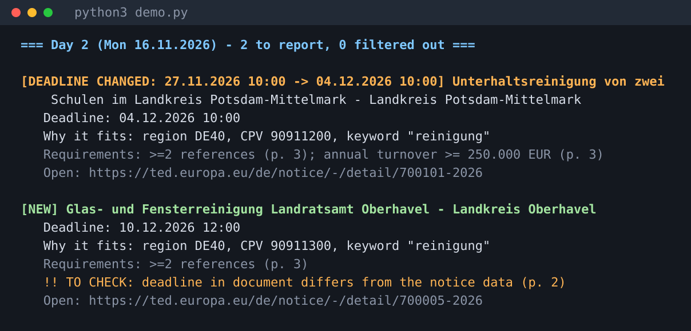

# TenderRadar

Finds public tenders that fit a service company (here: a cleaning firm in
Brandenburg/Berlin), tells the owner **what changed**, and says **what a human
should double-check** instead of guessing.



## The problem

A cleaning company wins work from public tenders, but nobody has time to read
the EU journal every day. Tenders get missed, and when a buyer quietly extends
or corrects a deadline in a *follow-up notice*, the company either misses it or
prepares an offer for the wrong date.

## What it does

1. **Fetches** new notices from the official [TED Search API v3](https://docs.ted.europa.eu/api/)
   (open data, no HTML scraping, no key needed for read-only search).
2. **Matches** them to a client profile (NUTS region, CPV codes, title keywords)
   and records *why* each one fits.
3. **Reads the tender documents** for the offer deadline and requirements
   (number of references, minimum turnover) and remembers the **page number**.
4. **Never guesses silently.** Anything uncertain is marked `TO CHECK`:
   - the document is a scan with no text layer,
   - the deadline in the document needed OCR-style repair (`11:OO` → `11:00`),
   - the deadline in the document differs from the notice data.
5. **Tracks changes.** A tender is identified by its *procedure id*, so a
   correction notice with a new publication number is recognised as the same
   tender, and a moved deadline becomes its own alert.
6. **Sends each alert at most once, and never loses one.** Nothing is saved as
   "known" until the digest was delivered (written, and e-mailed if asked). A
   failed e-mail leaves the changes pending, and the next run reports them again.
7. Writes a daily digest (text + HTML) in English, German or Polish and can
   **e-mail** it (SMTP, settings from environment variables).

## Run it (no network needed)

Python 3.9+, standard library only. On Windows also run `pip install tzdata`.

```
python3 demo.py                      # two days of synthetic data (creates fixtures/ on first run)
python3 -m unittest discover -s tests

python3 -m tenderradar run --profile fixtures/profile_cleaning_brandenburg.json \
    --fixtures fixtures/day1 --lang de
```

Live data from TED (needs internet), e-mailed to the owner:

```
export SMTP_HOST=smtp.example.com SMTP_USER=me@example.com SMTP_PASSWORD=... MAIL_FROM=me@example.com
python3 -m tenderradar run --profile fixtures/profile_cleaning_brandenburg.json \
    --source ted --days 3 --lang de --mail-to boss@example.com
```

## Layout

| Path | Purpose |
| --- | --- |
| `tenderradar/ted.py` | TED client (injectable HTTP, pagination) and notice parser |
| `tenderradar/extract.py` | Deadline and requirements from document text, with page numbers and confidence |
| `tenderradar/match.py` | Profile matching with reasons and rejections |
| `tenderradar/store.py` | SQLite state: known procedures, change events, sent alerts |
| `tenderradar/pipeline.py` | One run: parse → enrich → match → detect changes; `commit` after delivery |
| `tenderradar/digest.py` | Text/HTML digest in en/de/pl |
| `tenderradar/mailer.py` | SMTP e-mail (STARTTLS or SSL), connection injectable |
| `fixtures/make_fixtures.py` | Generates the synthetic notices, documents and profile for the offline demo |
| `tests/` | 25 tests (extraction, matching, change detection, pagination, e-mail, failed-delivery behaviour, end-to-end demo) |

## Honest limits (v1)

- The demo data is **synthetic** (fixtures shaped like TED responses). The TED
  request and field names follow the public API documentation, but this
  version has not yet been run against the live API; check field names in
  TED's Expert Search if a field comes back empty.
- Tender documents are **not downloaded** from TED yet; with `--source ted` the
  digest uses notice data only. Document reading works on text you give it.
- **No OCR engine is bundled.** A scan without a text layer is flagged, not
  silently ignored; plug your OCR output into `extract.enrich`.
- E-mail follows standard SMTP and is tested with a fake server connection; it
  has not been run against a live mail server from here.
- Only TED (above-threshold EU notices). National portals can be added as
  further sources behind the same `parse_notice` shape.

Data source: TED - Tenders Electronic Daily, © European Union, https://ted.europa.eu
